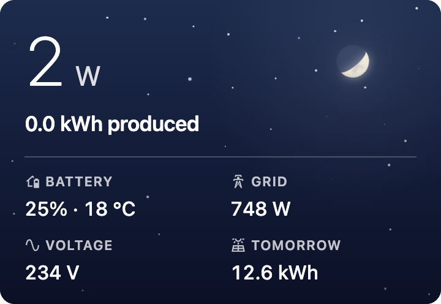

# Energy Sky Card

Une carte de tableau de bord Home Assistant qui affiche la production solaire, la batterie et le réseau sur un ciel qui porte une information : la couleur tarifaire du jour (EDF Tempo) en journée, un ciel étoilé la nuit.

*[English below](#english)*

| Jour Bleu | Jour Blanc |
|---|---|
|  |  |
| **Jour Rouge** | **Nuit** |
|  |  |

## Ce que montre la carte

- **Production solaire instantanée**, en grand : « 748 W », puis « 3,2 kW » à partir de 1 000 W.
- **Énergie produite aujourd'hui** : la somme de plusieurs compteurs journaliers. Un compteur indisponible est simplement laissé de côté.
- **Quatre mesures** (chacune facultative : une case sans entité disparaît) :
  - **Batterie** : charge en %, ↑ en charge, ↓ en décharge, et « · SOC atteint » quand la batterie a atteint la charge que vous visez (voir `soc_reached_entities` plus bas) ; rien sinon. Sur un écran trop étroit : « · SOC ✓ ».
  - **Réseau** : la puissance échangée avec le réseau, précédée d'un « - » en cas d'injection (« 748 W » acheté, « -1,8 kW » injecté).
  - **Tension** : en volts, ou « Coupure » quand l'alarme de perte réseau est déclenchée.
  - **Prévu demain** : la prévision de production en kWh.
- **Le fond** : un dégradé dans la couleur Tempo du jour, avec un halo solaire d'autant plus intense que la production est forte ; après le coucher du soleil, un ciel étoilé.
- **Des animations sobres** : le halo solaire respire (il pâlit et grandit) quand les panneaux produisent et des ombres de nuages traversent lentement la carte ; la nuit, les étoiles scintillent sur tout le ciel et des étoiles filantes passent de temps en temps, sans jamais passer sous le texte. Elles s'arrêtent quand la carte est hors écran ou l'onglet caché, et ne démarrent pas si l'appareil demande moins d'animations (`prefers-reduced-motion`).
- Une valeur indisponible s'affiche « — », jamais `unknown` ni `NaN`.

<!-- ha-marketplace:exclude-start -->
## Installation

### Marketplace (Home Assistant 2026.11 et plus)

1. **Paramètres → Marketplace**, menu **⋮ → Ajouter depuis un lien** (dépôt personnalisé).
2. Collez `https://github.com/macanto44/energy-sky-card`, catégorie **Dashboard**.
3. Installez **Energy Sky Card**, puis rechargez la page.

Avant 2026.11, la même chose se fait dans HACS : **⋮ → Dépôts personnalisés**, catégorie **Dashboard**.

### À la main

1. Téléchargez `energy-sky-card.js` et `energy-sky-card-editor.js` depuis la [dernière release](https://github.com/macanto44/energy-sky-card/releases) et copiez-les **dans le même dossier**, par exemple `/config/www/energy-sky-card/`.
2. **Paramètres → Tableaux de bord → ⋮ → Ressources**, ajoutez `/local/energy-sky-card/energy-sky-card.js?v=0.3.2`, type **Module JavaScript**.
<!-- ha-marketplace:exclude-end -->

## Configuration

Ajoutée depuis le sélecteur de cartes, elle se pré-remplit avec les capteurs du **tableau de bord Énergie** (production, batterie, réseau, et les capteurs des mêmes appareils : charge, température, tension, production du jour, prévision de demain) et la couleur Tempo du jour si une entité la donne. Vérifiez le sens des puissances (voir plus bas).

La carte se configure dans l'éditeur visuel (tout sauf les palettes) ou en YAML :

```yaml
type: custom:energy-sky-card
production_entity: sensor.solar_power
production_max: 6000
daily_production_entities:
  - sensor.solar_energy_today_roof
  - sensor.solar_energy_today_shed
battery:
  soc_entity: sensor.battery_soc
  power_entity: sensor.battery_power
  soc_reached_entities:
    - input_boolean.battery_target_reached
grid:
  power_entity: sensor.grid_power
  voltage_entity: sensor.grid_voltage
  outage_entity: sensor.grid_lost_alarm
  outage_states: [warning, alarm]
forecast_tomorrow_entity: sensor.energy_production_tomorrow
tariff_color_entity: sensor.edf_tempo_couleur_aujourd_hui
tap_action:
  action: navigate
  navigation_path: '#popup-flux-energie'
```

| Option | Défaut | Description |
|---|---|---|
| `production_entity` | **obligatoire** | Puissance solaire instantanée (W ; kW converti). Une entité, ou une liste additionnée (micro-onduleurs + onduleur de chaîne…) ; une entité indisponible est laissée de côté. |
| `production_max` | `6000` | Puissance (W) à laquelle le halo est au maximum. |
| `daily_production_entities` | — | Compteurs journaliers (kWh ; Wh converti), additionnés. Sans eux, pas de ligne « kWh produits ». |
| `battery.soc_entity` | — | Charge de la batterie (%). Sans elle, pas de case Batterie. |
| `battery.power_entity` | — | Puissance batterie (W), positive en charge : flèches ↑ / ↓. |
| `battery.temperature_entity` | — | Température de la batterie, affichée après la charge : « 78 % ↑ · 24 °C ». Sur une carte étroite, « 78 % ↑ · 24° ». |
| `battery.invert` | `false` | `true` si votre capteur est positif en **décharge** (Huawei, SolarEdge… selon l'intégration). |
| `battery.power_threshold` | `20` | En dessous de cette puissance (W), la batterie est au repos : pas de flèche. (Avant 0.1.2 : `power_threshold` au premier niveau, toujours accepté.) |
| `battery.soc_reached_entities` | — | Une ou plusieurs entités `on` / `off` (`input_boolean`, `binary_sensor`, `switch`) qui disent que la batterie a atteint sa charge cible. Si l'une est `on`, la case affiche « · SOC atteint » ; sinon rien. Sans elles, jamais de mention. (Avant 0.1.2 : `lock_entities`, toujours accepté.) |
| `grid.power_entity` | — | Puissance réseau (W), positive à l'achat. |
| `grid.invert` | `false` | `true` si votre capteur est positif à la **vente** (injection). |
| `grid.voltage_entity` | — | Tension réseau (V). |
| `grid.outage_entity` | — | Entité d'alarme de coupure. |
| `grid.outage_states` | `[warning, alarm]` | États de `outage_entity` qui signifient « Coupure ». |
| `forecast_tomorrow_entity` | — | Prévision de production pour demain (kWh). |
| `consumption_entity` | — | Consommation de la maison (W). Pour la case « Consommation » et `night_hero`. |
| `night_hero` | `production` | Ce que montre le grand chiffre la nuit : `production`, `consumption` (il faut `consumption_entity`) ou `battery` (il faut `battery.soc_entity`). La ligne du dessous dit alors ce que c'est : « Consommation · 7,2 kWh produits ». |
| `cells` | automatique | Les cases du bas, 4 au plus, dans l'ordre (voir plus bas). Sans elle : Batterie, Réseau, Tension, Prévu demain, selon les entités renseignées. |
| `tariff_color_entity` | — | Couleur tarifaire du jour (`Bleu`, `Blanc`, `Rouge`). Inconnue : Bleu. |
| `tariff_palettes` | voir plus bas | Remplace ou ajoute des palettes (YAML seulement). |
| `sun_entity` | `sun.sun` | `below_horizon` : la nuit. |
| `animate` | `true` | `false` coupe toutes les animations. |
| `tap_action`, `hold_action`, `double_tap_action` | plus d'infos sur la production | Les actions natives de Home Assistant (`navigate`, `more-info`, `perform-action`, `url`, `none`…). |

### Le sens des puissances

La carte attend une puissance réseau **positive à l'achat** et une puissance batterie **positive en charge**. Toutes les intégrations ne font pas ainsi : si la case Réseau affiche « -748 W » alors que vous achetez, ou ↓ alors que la batterie charge, ajoutez `invert: true` dans le bloc concerné (ou cochez « Inverser le signe du capteur » dans l'éditeur).

### Les cases

Par défaut, la carte montre les cases dont les entités sont renseignées. `cells` les choisit et les ordonne (4 au plus) : `battery`, `grid`, `voltage`, `tomorrow`, `consumption`, ou une case libre pour n'importe quelle entité, avec un nom et une icône facultatifs :

```yaml
consumption_entity: sensor.home_power
cells:
  - battery
  - grid
  - consumption
  - entity: sensor.ev_battery_level
    name: Voiture
    icon: mdi:car-electric
```

Une case libre affiche une puissance comme le reste de la carte (W / kW), et toute autre valeur comme Home Assistant la présente (unité, précision, états traduits). Sans nom, elle prend celui de l'entité ; sans icône, celle de l'entité.

**Un appui sur une case.** Chaque case peut avoir sa propre action, choisie dans l'éditeur (bloc Cases, « Appui sur la case ») ou en YAML avec `tap_action` : plus d'infos, naviguer, ouvrir une URL, lancer une action, rien… Une case intégrée s'écrit alors `{ type: …, tap_action: … }`. Sans action, un appui ouvre l'entité de la case (Batterie → la charge, Réseau → la puissance…), sauf si la carte a son propre `tap_action`, qui s'applique alors.

```yaml
cells:
  - type: battery
    tap_action:
      action: navigate
      navigation_path: /energy
  - type: grid
    tap_action:
      action: url
      url_path: https://www.services-rte.com
  - voltage
  - entity: sensor.ev_battery_level
    name: Voiture
    tap_action:
      action: more-info
```

### « SOC atteint »

La carte n'a pas d'avis sur ce qu'est une batterie « pleine » : c'est à vous de le dire avec une entité qui passe à `on`. Par exemple, un `binary_sensor` modèle allumé à partir de 95 % :

```yaml
template:
  - binary_sensor:
      - name: Battery target reached
        state: "{{ states('sensor.battery_soc') | float(0) >= 95 }}"
```

puis `soc_reached_entities: [binary_sensor.battery_target_reached]`. Si votre installation a déjà un interrupteur qui bloque la charge à un certain niveau, mettez-le directement.

### Ouvrir un pop-up Bubble Card

```yaml
tap_action:
  action: navigate
  navigation_path: '#popup-flux-energie'
```

### Palettes

Chaque palette donne trois couleurs, du haut vers le bas du dégradé (0 %, 60 %, 100 %) :

```yaml
tariff_palettes:
  Bleu: ['#4b90d5', '#2169b0', '#1d4f87']
  Blanc: ['#7b899c', '#5c6b81', '#4f5d72']
  Rouge: ['#d2766a', '#ac443a', '#76261f']
```

Les palettes par défaut sont légèrement plus sombres en haut que celles du prototype : avec celles d'origine, le texte blanc n'atteignait pas le contraste minimal (4,5:1 pour les valeurs, 3:1 pour les étiquettes et le grand chiffre). Un test vérifie chaque palette à l'endroit où se trouve le texte. Si vous fournissez vos propres couleurs, gardez-les assez sombres pour le texte blanc.

### Taille

Dans une vue « sections », la carte prend toute la largeur et 4 rangées (248 px), avec l'aération du prototype et les mesures ancrées en bas. Réduite à 3 rangées, elle passe à un espacement serré ; quand la largeur manque, le grand chiffre passe de 56 à 48 puis 40 px. Aucune ligne ne déborde à 320 px de large.

---

<a id="english"></a>

# English

A Home Assistant dashboard card showing solar production, battery and grid on a sky that carries information: the day's tariff colour (EDF Tempo) by day, a starry sky at night.

## What it shows

- **Solar power now**, large: "748 W", then "3.2 kW" from 1,000 W.
- **Energy produced today**: the sum of several daily meters; an unavailable one is left out.
- **Four metrics** (each optional: a cell without its entity disappears): **Battery** (SOC %, ↑ charging / ↓ discharging, "SOC reached" when the battery has reached your target, see `soc_reached_entities`), **Grid** (the power exchanged, with a "-" when exporting: "748 W" bought, "-1.8 kW" sent back), **Voltage** (or "Outage"), **Tomorrow** (forecast kWh).
- **Background**: the tariff colour by day with a sun halo scaled to production; a starry sky after sunset.
- **Quiet animations**: the sun halo breathes (fading and growing) while the panels produce and cloud shadows drift slowly across the card; at night stars twinkle across the whole sky and shooting stars pass now and then, never under the text. Paused off-screen and in hidden tabs; none with `prefers-reduced-motion` or `animate: false`.
- No reading shows "—", never `unknown` or `NaN`. The card speaks French and English, and follows your profile's number format.

<!-- ha-marketplace:exclude-start -->
## Installation

**Marketplace (Home Assistant 2026.11+)**: Settings → Marketplace → ⋮ → Add from link, `https://github.com/macanto44/energy-sky-card`, category **Dashboard**. Before 2026.11, add it to HACS as a custom repository (category **Dashboard**).

**Manually**: copy `energy-sky-card.js` and `energy-sky-card-editor.js` from the [latest release](https://github.com/macanto44/energy-sky-card/releases) into the same folder (e.g. `/config/www/energy-sky-card/`) and add `/local/energy-sky-card/energy-sky-card.js?v=0.3.2` as a JavaScript module resource.
<!-- ha-marketplace:exclude-end -->

## Configuration

Added from the card picker, it fills itself in from the **Energy dashboard** (production, battery, grid, and the sensors on the same devices: charge, temperature, voltage, energy today, tomorrow's forecast) and today's Tempo colour when an entity gives it. Check the power signs (`invert`).

Use the visual editor (everything but the palettes) or YAML. The options are those of the table above:

| Option | Default | Description |
|---|---|---|
| `production_entity` | **required** | Solar power now (W; kW converted). One entity, or a list that is summed (micro-inverters + string inverter…); an unavailable one is left out. |
| `production_max` | `6000` | Power (W) at which the halo is strongest. |
| `daily_production_entities` | — | Daily energy meters (kWh), summed. |
| `battery.soc_entity` / `power_entity` | — | SOC (%), power (W, positive when charging). |
| `battery.temperature_entity` | — | Battery temperature, shown after the charge: "78% ↑ · 24 °C" ("78% ↑ · 24°" on a narrow card). |
| `battery.invert` / `grid.invert` | `false` | `true` when your sensor is positive when discharging / exporting (the card expects positive when charging / importing). |
| `battery.power_threshold` | `20` | Below this power (W) the battery is idle: no ↑ / ↓ arrow. Before 0.1.2: top-level `power_threshold`, still accepted. |
| `battery.soc_reached_entities` | — | On / off entities (`input_boolean`, `binary_sensor`, `switch`) saying the battery has reached its target charge: when any is on, the cell reads "· SOC reached". E.g. a template `binary_sensor` with `{{ states('sensor.battery_soc') \| float(0) >= 95 }}`. Before 0.1.2: `lock_entities`, still accepted. |
| `grid.power_entity` / `voltage_entity` / `outage_entity` | — | Power (W, positive when importing), voltage (V), outage alarm. |
| `grid.outage_states` | `[warning, alarm]` | States of `outage_entity` that mean an outage. |
| `forecast_tomorrow_entity` | — | Tomorrow's production forecast (kWh). |
| `consumption_entity` | — | The home's power use (W), for the Consumption cell and `night_hero`. |
| `night_hero` | `production` | What the big number shows at night: `production`, `consumption` or `battery`; the line below names it ("Consumption · 7.2 kWh produced"). |
| `cells` | automatic | Up to 4 bottom cells, in order: `battery`, `grid`, `voltage`, `tomorrow`, `consumption`, or a free cell `{ entity, name, icon }` for any entity (powers read in W / kW, anything else as Home Assistant formats it). Each cell can take its own `tap_action` (a built-in one is then written `{ type: grid, tap_action: … }`), also set in the editor's Cells block; without one, a tap opens the cell's entity, unless the card has a `tap_action`. |
| `tariff_color_entity` | — | Today's tariff colour (`Bleu`, `Blanc`, `Rouge`); unknown is Bleu. |
| `tariff_palettes` | see above | Three colours per tariff, top to bottom (YAML only). |
| `sun_entity` | `sun.sun` | `below_horizon` means night. |
| `animate` | `true` | `false` turns every animation off. |
| `tap_action`, `hold_action`, `double_tap_action` | more-info of production | Home Assistant's own actions. `navigate` to `'#my-popup'` opens a Bubble Card pop-up. |

The default palettes are slightly darker at the top than the original prototype's, so white text meets WCAG contrast where it sits (tested).

## Development

```bash
npm install
npm run build          # energy-sky-card.js and energy-sky-card-editor.js
npm run type-check
npm test               # Vitest
npm run test:browser   # headless Chrome: animations pause off-screen, nothing overflows at 320 px
npm run screenshots    # the pictures above, from the demo
```

`demo/index.html` runs the built card on sample readings; `demo/shot.sh` screenshots it. See [CLAUDE.md](CLAUDE.md) for a map of the code.

## License

MIT — see [LICENSE](LICENSE). Third-party notices: [NOTICE.md](NOTICE.md).
