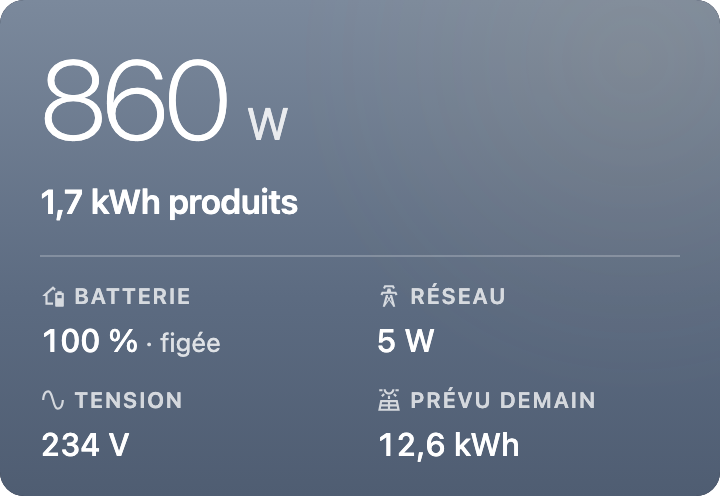
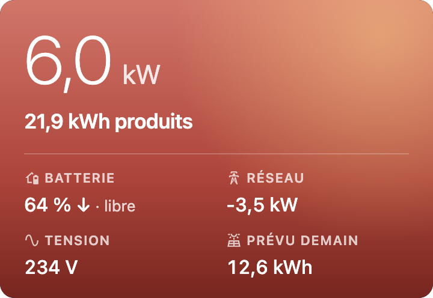
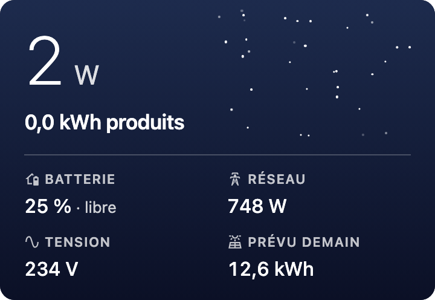

# Energy Sky Card

Une carte de tableau de bord Home Assistant qui affiche la production solaire, la batterie et le réseau sur un ciel qui porte une information : la couleur tarifaire du jour (EDF Tempo) en journée, un ciel étoilé la nuit.

*[English below](#english)*

| Jour Bleu | Jour Blanc |
|---|---|
|  |  |
| **Jour Rouge** | **Nuit** |
|  |  |

## Ce que montre la carte

- **Production solaire instantanée**, en grand : « 748 W », puis « 3,2 kW » à partir de 1 000 W.
- **Énergie produite aujourd'hui** : la somme de plusieurs compteurs journaliers. Un compteur indisponible est simplement laissé de côté.
- **Quatre mesures** (chacune facultative : une case sans entité disparaît) :
  - **Batterie** : charge en %, ↑ en charge, ↓ en décharge, et « · figée » si l'un des verrous est actif, sinon « · libre ».
  - **Réseau** : la puissance échangée avec le réseau, précédée d'un « - » en cas d'injection (« 748 W » acheté, « -1,8 kW » injecté).
  - **Tension** : en volts, ou « Coupure » quand l'alarme de perte réseau est déclenchée.
  - **Prévu demain** : la prévision de production en kWh.
- **Le fond** : un dégradé dans la couleur Tempo du jour, avec un halo solaire d'autant plus intense que la production est forte ; après le coucher du soleil, un ciel étoilé.
- **Des animations sobres** : le halo respire lentement quand les panneaux produisent, quelques étoiles scintillent. Elles s'arrêtent quand la carte est hors écran ou l'onglet caché, et ne démarrent pas si l'appareil demande moins d'animations (`prefers-reduced-motion`).
- Une valeur indisponible s'affiche « — », jamais `unknown` ni `NaN`.

<!-- ha-marketplace:exclude-start -->
## Installation

### Marketplace (Home Assistant 2026.11 et plus)

1. **Paramètres → Marketplace**, menu **⋮ → Ajouter depuis un lien** (dépôt personnalisé).
2. Collez `https://github.com/macanto44/energy-sky-card`, catégorie **Dashboard**.
3. Installez **Energy Sky Card**, puis rechargez la page.

Avant 2026.11, la même chose se fait dans HACS : **⋮ → Dépôts personnalisés**, catégorie **Dashboard**.

### À la main

1. Téléchargez `energy-sky-card.js` et `energy-sky-card-editor.js` depuis la [dernière release](https://github.com/macanto44/energy-sky-card/releases) et copiez-les **dans le même dossier**, par exemple `/config/www/energy-sky-card/`.
2. **Paramètres → Tableaux de bord → ⋮ → Ressources**, ajoutez `/local/energy-sky-card/energy-sky-card.js?v=0.1.1`, type **Module JavaScript**.
<!-- ha-marketplace:exclude-end -->

## Configuration

La carte se configure dans l'éditeur visuel (tout sauf les palettes) ou en YAML :

```yaml
type: custom:energy-sky-card
production_entity: sensor.solar_power
production_max: 6000
daily_production_entities:
  - sensor.solar_energy_today_roof
  - sensor.solar_energy_today_shed
battery:
  soc_entity: sensor.battery_soc
  power_entity: sensor.battery_power
  lock_entities:
    - input_boolean.battery_lock
grid:
  power_entity: sensor.grid_power
  voltage_entity: sensor.grid_voltage
  outage_entity: sensor.grid_lost_alarm
  outage_states: [warning, alarm]
forecast_tomorrow_entity: sensor.energy_production_tomorrow
tariff_color_entity: sensor.edf_tempo_couleur_aujourd_hui
tap_action:
  action: navigate
  navigation_path: '#popup-flux-energie'
```

| Option | Défaut | Description |
|---|---|---|
| `production_entity` | **obligatoire** | Puissance solaire instantanée (W ; kW converti). |
| `production_max` | `6000` | Puissance (W) à laquelle le halo est au maximum. |
| `daily_production_entities` | — | Compteurs journaliers (kWh ; Wh converti), additionnés. Sans eux, pas de ligne « kWh produits ». |
| `battery.soc_entity` | — | Charge de la batterie (%). Sans elle, pas de case Batterie. |
| `battery.power_entity` | — | Puissance batterie (W), positive en charge : flèches ↑ / ↓. |
| `battery.lock_entities` | — | Entités `on` / `off` : « figée » si l'une est `on`, sinon « libre ». Sans elles, pas de complément. |
| `grid.power_entity` | — | Puissance réseau (W), positive à l'achat. |
| `grid.voltage_entity` | — | Tension réseau (V). |
| `grid.outage_entity` | — | Entité d'alarme de coupure. |
| `grid.outage_states` | `[warning, alarm]` | États de `outage_entity` qui signifient « Coupure ». |
| `forecast_tomorrow_entity` | — | Prévision de production pour demain (kWh). |
| `tariff_color_entity` | — | Couleur tarifaire du jour (`Bleu`, `Blanc`, `Rouge`). Inconnue : Bleu. |
| `tariff_palettes` | voir plus bas | Remplace ou ajoute des palettes (YAML seulement). |
| `sun_entity` | `sun.sun` | `below_horizon` : la nuit. |
| `power_threshold` | `20` | Seuil (W) des flèches ↑ / ↓ de la batterie. |
| `animate` | `true` | `false` coupe toutes les animations. |
| `tap_action`, `hold_action`, `double_tap_action` | plus d'infos sur la production | Les actions natives de Home Assistant (`navigate`, `more-info`, `perform-action`, `url`, `none`…). |

### Ouvrir un pop-up Bubble Card

```yaml
tap_action:
  action: navigate
  navigation_path: '#popup-flux-energie'
```

### Palettes

Chaque palette donne trois couleurs, du haut vers le bas du dégradé (0 %, 60 %, 100 %) :

```yaml
tariff_palettes:
  Bleu: ['#4b90d5', '#2169b0', '#1d4f87']
  Blanc: ['#7b899c', '#5c6b81', '#4f5d72']
  Rouge: ['#d2766a', '#ac443a', '#76261f']
```

Les palettes par défaut sont légèrement plus sombres en haut que celles du prototype : avec celles d'origine, le texte blanc n'atteignait pas le contraste minimal (4,5:1 pour les valeurs, 3:1 pour les étiquettes et le grand chiffre). Un test vérifie chaque palette à l'endroit où se trouve le texte. Si vous fournissez vos propres couleurs, gardez-les assez sombres pour le texte blanc.

### Taille

Dans une vue « sections », la carte prend toute la largeur et 4 rangées (248 px), avec l'aération du prototype et les mesures ancrées en bas. Réduite à 3 rangées, elle passe à un espacement serré ; quand la largeur manque, le grand chiffre passe de 56 à 48 puis 40 px. Aucune ligne ne déborde à 320 px de large.

---

<a id="english"></a>

# English

A Home Assistant dashboard card showing solar production, battery and grid on a sky that carries information: the day's tariff colour (EDF Tempo) by day, a starry sky at night.

## What it shows

- **Solar power now**, large: "748 W", then "3.2 kW" from 1,000 W.
- **Energy produced today**: the sum of several daily meters; an unavailable one is left out.
- **Four metrics** (each optional: a cell without its entity disappears): **Battery** (SOC %, ↑ charging / ↓ discharging, "locked" / "free"), **Grid** (the power exchanged, with a "-" when exporting: "748 W" bought, "-1.8 kW" sent back), **Voltage** (or "Outage"), **Tomorrow** (forecast kWh).
- **Background**: the tariff colour by day with a sun halo scaled to production; a starry sky after sunset.
- **Quiet animations**: the halo breathes while the panels produce, a few stars twinkle. Paused off-screen and in hidden tabs; none with `prefers-reduced-motion` or `animate: false`.
- No reading shows "—", never `unknown` or `NaN`. The card speaks French and English, and follows your profile's number format.

<!-- ha-marketplace:exclude-start -->
## Installation

**Marketplace (Home Assistant 2026.11+)**: Settings → Marketplace → ⋮ → Add from link, `https://github.com/macanto44/energy-sky-card`, category **Dashboard**. Before 2026.11, add it to HACS as a custom repository (category **Dashboard**).

**Manually**: copy `energy-sky-card.js` and `energy-sky-card-editor.js` from the [latest release](https://github.com/macanto44/energy-sky-card/releases) into the same folder (e.g. `/config/www/energy-sky-card/`) and add `/local/energy-sky-card/energy-sky-card.js?v=0.1.1` as a JavaScript module resource.
<!-- ha-marketplace:exclude-end -->

## Configuration

Use the visual editor (everything but the palettes) or YAML. The options are those of the table above:

| Option | Default | Description |
|---|---|---|
| `production_entity` | **required** | Solar power now (W; kW converted). |
| `production_max` | `6000` | Power (W) at which the halo is strongest. |
| `daily_production_entities` | — | Daily energy meters (kWh), summed. |
| `battery.soc_entity` / `power_entity` / `lock_entities` | — | SOC (%), power (W, positive when charging), lock switches. |
| `grid.power_entity` / `voltage_entity` / `outage_entity` | — | Power (W, positive when importing), voltage (V), outage alarm. |
| `grid.outage_states` | `[warning, alarm]` | States of `outage_entity` that mean an outage. |
| `forecast_tomorrow_entity` | — | Tomorrow's production forecast (kWh). |
| `tariff_color_entity` | — | Today's tariff colour (`Bleu`, `Blanc`, `Rouge`); unknown is Bleu. |
| `tariff_palettes` | see above | Three colours per tariff, top to bottom (YAML only). |
| `sun_entity` | `sun.sun` | `below_horizon` means night. |
| `power_threshold` | `20` | Threshold (W) for the battery ↑ / ↓ arrows. |
| `animate` | `true` | `false` turns every animation off. |
| `tap_action`, `hold_action`, `double_tap_action` | more-info of production | Home Assistant's own actions. `navigate` to `'#my-popup'` opens a Bubble Card pop-up. |

The default palettes are slightly darker at the top than the original prototype's, so white text meets WCAG contrast where it sits (tested).

## Development

```bash
npm install
npm run build          # energy-sky-card.js and energy-sky-card-editor.js
npm run type-check
npm test               # Vitest
npm run test:browser   # headless Chrome: animations pause off-screen, nothing overflows at 320 px
```

`demo/index.html` runs the built card on sample readings; `demo/shot.sh` screenshots it. See [CLAUDE.md](CLAUDE.md) for a map of the code.

## License

MIT — see [LICENSE](LICENSE). Third-party notices: [NOTICE.md](NOTICE.md).
