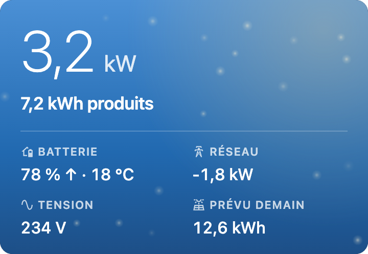
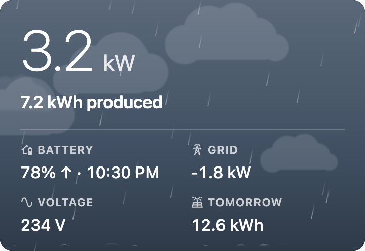
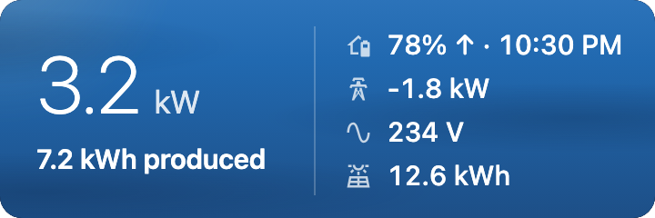
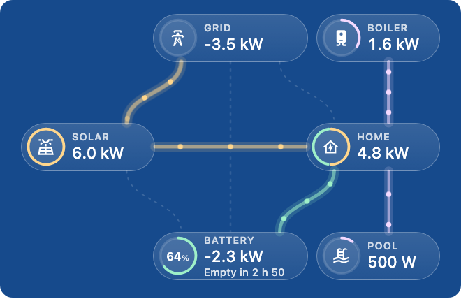
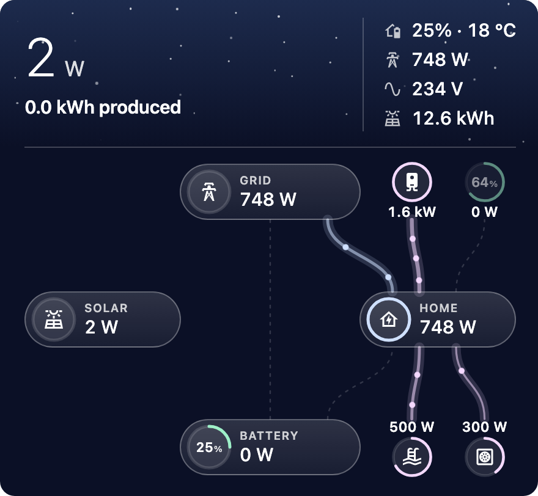

# Energy Sky Card

**Your solar power, under your own sky.**

[](https://github.com/macanto44/energy-sky-card/releases)
[](https://github.com/macanto44/energy-sky-card)
[](https://www.home-assistant.io/)
[](https://github.com/macanto44/energy-sky-card/blob/main/LICENSE)

| Bleu day | Blanc day |
|---|---|
|  |  |
| **Rouge day** | **Night** |
|  |  |

Energy Sky Card is a Home Assistant dashboard card for homes with solar panels, and optionally a battery. It shows how much the panels produce right now, what they made today, and your battery and grid, on a background that tells you something too: by day, the colour of today's electricity tariff (EDF Tempo's Bleu, Blanc and Rouge days), or the weather outside, or simply a colour of your choosing; a starry sky by night. Tap the big number and the card unfolds to show where the energy is going.

It's free, open source and made for Home Assistant. The card is in French and English. You can [try it live](https://macanto44.github.io/energy-sky-card/) in your browser first, on sample readings.

[Live demo](https://macanto44.github.io/energy-sky-card/) · [Install](#install) · [Set up](#set-up) · [Examples](#examples) · [Options](#options) · [Troubleshooting](#troubleshooting)

<!-- ha-marketplace:exclude-start -->
## Install

[](https://my.home-assistant.io/redirect/hacs_repository/?owner=macanto44&repository=energy-sky-card&category=plugin)

The button opens the card in your Home Assistant's Marketplace, which offers to add the repository if it doesn't know it yet. Or, by hand:

### Marketplace (Home Assistant 2026.11 and later)

1. Go to **Settings → Marketplace**, select **⋮ → Add from link** and enter `https://github.com/macanto44/energy-sky-card`, as a **Dashboard**.
2. Install **Energy Sky Card**.
3. Refresh your browser.

New versions show up under **Settings → Updates**.

### Manual

The card ships as two files that sit in the same folder:

| File | What it is |
| --- | --- |
| `energy-sky-card.js` | The card. This is the only dashboard resource. |
| `energy-sky-card-editor.js` | The visual editor. It loads the first time you open the card's settings. |

1. Download [`energy-sky-card.js`](https://github.com/macanto44/energy-sky-card/releases/latest/download/energy-sky-card.js) and [`energy-sky-card-editor.js`](https://github.com/macanto44/energy-sky-card/releases/latest/download/energy-sky-card-editor.js) from the [latest release](https://github.com/macanto44/energy-sky-card/releases/latest).
2. Copy both to the same folder, for example `/config/www/energy-sky-card/`.
3. Go to **Settings → Dashboards → ⋮ → Resources → Add resource** and add:
   - URL: `/local/energy-sky-card/energy-sky-card.js?v=0.3.8`
   - Type: **JavaScript module**
4. Refresh your browser.

To update, overwrite both files and raise the `?v=` in the resource URL so browsers fetch the new version. The editor picks up the same `?v=` by itself.
<!-- ha-marketplace:exclude-end -->

---

## Your sky: the tariff, one colour, or the weather.

Choose what's behind the numbers (`background`, or **Background** in the editor's Sky section):

- **Tempo** (the default): by day, a gradient in today's tariff colour, read from a sensor such as the EDF Tempo integration's. Any tariff sensor works: the palettes are keyed by its states, and you can add your own.
- **Solid**: one colour of your choosing. The card draws a gentle gradient from it, and darkens it if need be so the white text always reads.
- **Weather**: the sky follows a weather entity. Clouds drift across, rain slants down, snow falls, fog breathes, lightning flashes now and then; the wind hurries the clouds. Every weather sky keeps white text readable with its clouds or fog passing behind it.

A sun halo in the corner grows with your production: faint on a grey morning, bright at noon (with the weather sky, when the sun is out). After sunset, the sky turns to night; with the weather, clouds and rain stay, and the stars only shine through a clear sky.



## Quiet, not busy.

The halo breathes slowly while the panels produce, and cloud shadows drift across the card (under the weather sky: clouds, rain, snow, fog or lightning, as outside). At night, stars twinkle over the whole sky and a shooting star passes now and then. Nothing ever moves behind the text, and nothing moves at all when the card is off-screen, the tab is hidden, your device asks for reduced motion, or you set `animate: false`. Day and night cross-fade over three seconds.

## What it shows.

- **Solar power now**, large: `748 W`, then `3.2 kW` from 1,000 W. Several production sensors (micro-inverters and a string inverter, say) are added up.
- **Energy produced today**, the sum of your daily meters: `7.2 kWh produced`.
- **Up to four cells** below:
  - **Battery**: the charge, `↑` when charging, `↓` when discharging, the temperature if you have it (`78 % ↑ · 18 °C`), and `· SOC reached` when it has reached the charge you aim for.
  - **Grid**: the power exchanged, with a `-` when you sell: `748 W` bought, `-1.8 kW` sold.
  - **Voltage**, or `Outage` when your grid-loss alarm goes off.
  - **Tomorrow**: the production forecast.
  - **Consumption**: your home's power use.
  - **Any entity you like**, with your own name and icon.
- At night, the big number can show your **home's consumption** or the **battery's charge** instead of a production of zero.
- A reading that isn't available shows `—`, never `unknown` or `NaN`.
- **Something wrong shows**: during a grid outage the flow's Grid node turns red and reads `Outage`, with nothing flowing through the grid. A reading that has gone quiet (no report from its integration for 30 minutes) is flagged: its cell's icon turns to a clock, its flow node's border to dashes, and both say how long it's been.

## Two shapes.

The **standard** layout puts the cells under the big number, in four rows. The **side** layout lists them on the right, an icon and a value per line, in two rows: half the height for the same readings.



## The energy flow.

Under the card, in either layout, the energy flows between four nodes: the sun on the left, the home on the right, the grid above and the battery below. Show it two ways:

- `flow: tap`: a tap on the big number or the line under it unfolds the card, and a tap on the unfolded part folds it again. A small handle under the card hints at it.
- `flow: always`: the flow is always there, under the card.




- **The colour says where the energy comes from**: gold for the sun, mint for the battery, ice blue for the grid. Energy you sell stays gold on its way to the grid.
- **The wire says how much**: the more power, the thicker the wire and the more and faster the dots that run along it. An idle wire is a faint dotted line.
- **The grid ↔ battery link** runs down the middle, under the sun → home wire (a small gap shows it's a bridge, not a junction). It lights up when the grid charges the battery, at off-peak hours for instance, or when the battery sells.
- **The flows add up like your meters.** What you sell comes from the sun first, then the battery. What charges the battery comes from the sun first, then the grid. The home gets the rest. A battery below its idle threshold moves nothing.
- **Each node** shows its power with the card's signs (grid negative when selling, battery negative when discharging) and a ring: production against your maximum, the battery's charge (with the percentage in the middle), and the share of each source in what your home uses.
- **It keeps its shape**: the flow's height follows its width (65 % of it, from 220 to 360 px), so it's never squashed on a wide card.
- **Tap a node** to open its entity.
- **Your appliances**, up to four (a water heater, a pool pump, a car charger…), sit around the home: the first above it, the second below, then in turn. Each shows its power, a ring with its share of what the home uses, and a lilac wire from the home that busies up with its power. One or two get a whole node with their name when the card is wide enough; more, or on a phone, they turn compact (the icon in its ring and the power; the name on hover and for screen readers), and a phone shows the first two. Tap one to open its entity, or give it a `tap_action` of its own. An appliance below 10 W (`consumer_threshold`) stays out of the flow, and the others move up.



With `flow: tap`, the rest of the card keeps its own tap action, so a menu or a pop-up you open from the card still works; with `flow: always`, the big number keeps it too. Hold and double tap stay the card's everywhere.

## At home on any screen.

In the sections view the card takes the full width. It fits a 320 px phone without cutting a word: the big number steps down from 56 to 48 and 40 px, the spacing tightens at three rows, and long complements shorten (`· SOC reached` → `· SOC ✓`, `18 °C` → `18°`). Numbers follow your profile's number format (`3,2 kW` or `3.2 kW`).

White text keeps at least a 4.5:1 contrast where it sits on every default palette, day and night, on every weather sky with its clouds passing behind, and on your own solid colour (darkened if need be). A test checks it.

---

## Set up

1. Edit your dashboard, select **Add card** and search for **Energy Sky Card**.
2. The card fills itself in from your **Energy dashboard**: solar, battery and grid power, plus the sensors on the same devices (battery charge and temperature, grid voltage, today's energy, tomorrow's forecast), and today's Tempo colour if an entity gives it. Without an Energy dashboard, it starts on the first power sensor it finds.
3. **Check the signs.** The card expects grid power positive when you buy, and battery power positive when it charges. If the Grid cell reads `-748 W` while you're buying, or the battery shows `↓` while charging, tick **Flip the sensor's sign** in the Grid or Battery section.
4. Adjust the rest in the editor's sections: **Production**, **Battery**, **Grid**, **Layout** (standard or side, the big number at night, and the energy flow), **Cells** (the four cells and their taps), **Appliances** (the home's consumption, and your appliances with a flow), **Sky** (Tempo, solid or weather, the sun, animations), and **Actions**.

Everything is in the editor except the palettes, which are YAML only. In YAML, the smallest card is:

```yaml
type: custom:energy-sky-card
production_entity: sensor.solar_power
```

## Examples

Every example below is a complete card configuration. Replace the entity IDs with your own.

### Solar, battery and grid

```yaml
type: custom:energy-sky-card
production_entity: sensor.solar_power
production_max: 6000
daily_production_entities:
  - sensor.solar_energy_today_roof
  - sensor.solar_energy_today_shed
battery:
  soc_entity: sensor.battery_soc
  power_entity: sensor.battery_power
  temperature_entity: sensor.battery_temperature
grid:
  power_entity: sensor.grid_power
  voltage_entity: sensor.grid_voltage
  outage_entity: sensor.grid_lost_alarm
forecast_tomorrow_entity: sensor.energy_production_tomorrow
tariff_color_entity: sensor.edf_tempo_couleur_aujourd_hui
```

### Compact, with the flow

Two rows on the dashboard, the energy flow one tap away. The home's consumption makes the Home node tappable and can take over the big number at night.

```yaml
type: custom:energy-sky-card
layout: side
flow: tap
production_entity:
  - sensor.micro_inverters_power
  - sensor.string_inverter_power
consumption_entity: sensor.home_power
night_hero: consumption
daily_production_entities:
  - sensor.solar_energy_today
battery:
  soc_entity: sensor.battery_soc
  power_entity: sensor.battery_power
  invert: true
grid:
  power_entity: sensor.grid_power
tariff_color_entity: sensor.edf_tempo_couleur_aujourd_hui
hold_action:
  action: navigate
  navigation_path: /energy
```

### Your appliances in the flow

Up to four, around the home, with the flow shown:

```yaml
type: custom:energy-sky-card
production_entity: sensor.solar_power
flow: always
consumption_entity: sensor.home_power
consumers:
  - entity: sensor.water_heater_power
    name: Water heater
    icon: mdi:water-boiler
  - entity: sensor.pool_pump_power
    name: Pool
    icon: mdi:pool
  - entity: sensor.ev_charger_power
    name: Car
    icon: mdi:car-electric
    tap_action:
      action: navigate
      navigation_path: /car
```

### Your own cells

Pick up to four cells and their order. A free cell shows any entity; each cell can have its own tap action.

```yaml
type: custom:energy-sky-card
production_entity: sensor.solar_power
consumption_entity: sensor.home_power
battery:
  soc_entity: sensor.battery_soc
  power_entity: sensor.battery_power
grid:
  power_entity: sensor.grid_power
cells:
  - battery
  - type: grid
    tap_action:
      action: navigate
      navigation_path: /energy
  - consumption
  - entity: sensor.ev_battery_level
    name: Car
    icon: mdi:car-electric
```

### "SOC reached"

The card has no opinion on what a full battery is: an entity tells it. A template binary sensor that turns on from 95 %:

```yaml
template:
  - binary_sensor:
      - name: Battery target reached
        state: "{{ states('sensor.battery_soc') | float(0) >= 95 }}"
```

Then, in the card:

```yaml
battery:
  soc_entity: sensor.battery_soc
  soc_reached_entities:
    - binary_sensor.battery_target_reached
```

If your installation already has a switch or an `input_boolean` that holds the charge at a level, use it directly. When any of the entities is on, the Battery cell reads `· SOC reached`.

### A pop-up on tap

The card's tap action can open a [Bubble Card](https://github.com/Clooos/Bubble-Card) pop-up, or anything else Home Assistant's actions do:

```yaml
tap_action:
  action: navigate
  navigation_path: '#energy-popup'
```

### Your own palettes

Each palette is three colours, from the top of the gradient to the bottom (0 %, 60 %, 100 %), keyed by your tariff sensor's states (case doesn't matter). These are the defaults; add a key for any other state your sensor has:

```yaml
tariff_palettes:
  Bleu: ['#4b90d5', '#2169b0', '#1d4f87']
  Blanc: ['#7b899c', '#5c6b81', '#4f5d72']
  Rouge: ['#d2766a', '#ac443a', '#76261f']
```

Keep your colours dark enough for white text: the defaults are a little darker at the top than they could be, so that the values keep a 4.5:1 contrast.

### The flow's colours

The flow's wires and rings take one colour per source. Change them for one card with the colour pickers in the editor's **Layout** section (shown with a flow), or with `flow_colors` in YAML (any CSS colour, a theme variable too):

```yaml
flow_colors:
  solar: '#ffb300'
  grid: '#90caf9'
  battery: '#a5d6a7'
  consumption: var(--accent-color)
```

Or for every card, in your Home Assistant theme:

```yaml
my_theme:
  energy-sky-card-solar: '#ffb300'
  energy-sky-card-grid: '#90caf9'
  energy-sky-card-battery: '#a5d6a7'
  energy-sky-card-consumption: '#f48fb1'
```

A card's `flow_colors` wins over the theme. The text stays white on the card's own sky, whatever the theme.

## Options

`type: custom:energy-sky-card`

### Production

| Option | Default | Description |
| --- | --- | --- |
| `production_entity` | **required** | Solar power now, in W (kW and MW are converted). One entity, or a list that is added up. An unavailable one is left out of the sum |
| `smoothing` | `0` | Seconds: the powers shown (big number, cells, flow, halo) are each sensor's average over this long (worked out again every 5 s), so passing clouds don't make the numbers jump. `0` shows readings as they come |
| `production_threshold` | — | Below this power, in W, the production reads 0: a charge controller drawing a few watts on the solar line no longer shows as production. No threshold by default |
| `production_max` | `6000` | The power, in W, at which the sun halo is at its brightest. Also the full circle of the Sun node's ring |
| `daily_production_entities` | — | Daily energy meters, in kWh (Wh and MWh are converted), added up for the `kWh produced` line. An unavailable one is left out; with none available, the line reads `— kWh produced`. Without them, no line |
| `forecast_tomorrow_entity` | — | Tomorrow's production forecast, in kWh, for the Tomorrow cell |
| `consumption_entity` | — | Your home's power use, in W, for the Consumption cell, `night_hero` and the Home node. Without it, the flow works out the home from the other readings |
| `stale_after` | `30` | Minutes without a new reading before a measure is flagged as stale (its cell's icon turns to a clock). Read from `last_reported` (Home Assistant 2024.3+), so a value that simply doesn't change, like a battery idling at 0 W, isn't flagged. `0` turns it off |
| `night_hero` | `production` | What the big number shows below the horizon: `production`, `consumption` (needs `consumption_entity`) or `battery` (the charge; needs `battery.soc_entity`). The line under it then names it: `Consumption · 7.2 kWh produced` |

### Battery

All under `battery:`.

| Option | Default | Description |
| --- | --- | --- |
| `soc_entity` | — | The battery's charge, in %. Without it, no Battery cell |
| `power_entity` | — | The battery's power, in W, positive when charging: the `↑` / `↓` arrows and the flow |
| `temperature_entity` | — | The battery's temperature, shown after the charge in its sensor's unit: `78 % ↑ · 24 °C` |
| `invert` | `false` | `true` if your sensor is positive when **discharging** (it depends on the integration) |
| `power_threshold` | `20` | Below this power, in W, the battery is idle: no arrow, and no energy in the flow |
| `soc_reached_entities` | — | On / off entities (`input_boolean`, `binary_sensor`, `switch`) that say the battery has reached its target charge. When any is on, the cell reads `· SOC reached`; otherwise nothing |

### Grid

All under `grid:`.

| Option | Default | Description |
| --- | --- | --- |
| `power_entity` | — | Power exchanged with the grid, in W, positive when buying. Without it, no Grid cell and no Grid node |
| `invert` | `false` | `true` if your sensor is positive when **selling** |
| `voltage_entity` | — | Grid voltage, in V, for the Voltage cell |
| `outage_entity` | — | A grid-loss alarm. While it's in one of `outage_states`, the Voltage cell reads `Outage` |
| `outage_states` | `[warning, alarm]` | The states of `outage_entity` that mean an outage |

### Layout and cells

| Option | Default | Description |
| --- | --- | --- |
| `layout` | `standard` | `standard`: the cells under the big number, four rows (248 px). `side`: the cells on the right, one line each, the icon standing for the name, two rows (120 px) |
| `flow` | none | The energy flow under the card: `tap` (unfolded by a tap on the big number or its line) or `always` (always shown). See [The energy flow](#the-energy-flow). 0.3.3's `expandable: true` still reads as `flow: tap` |
| `consumer_threshold` | `10` | Below this power, in W, an appliance stays out of the flow (as does one without a reading); the others take its place. `0` always shows them |
| `consumers` | — | Up to four appliances in the energy flow, around the home (needs `flow`): each `{ entity, name, icon, tap_action }`, the entity a power sensor. `name` and `icon` default to the entity's. See [The energy flow](#the-energy-flow) |
| `cells` | automatic | Up to four cells, in order. Without it: Battery, Grid, Voltage and Tomorrow, those whose entities are set. See below |

Each entry in `cells` is one of:

| Entry | Shows |
| --- | --- |
| `battery` | The charge, arrow, temperature and `SOC reached` |
| `grid` | The grid power, `-` when selling |
| `voltage` | The voltage, or `Outage` |
| `tomorrow` | Tomorrow's forecast |
| `consumption` | The home's power use (needs `consumption_entity`) |
| `{ type: grid, tap_action: … }` | A built-in cell with a tap action of its own |
| `{ entity: …, name: …, icon: …, tap_action: … }` | A free cell: any entity. Powers read like the rest of the card (W / kW); anything else as Home Assistant formats it. `name` and `icon` default to the entity's |

A cell without its own `tap_action` opens its entity, unless the card has a `tap_action`, which then applies to the whole card.

### Sky

| Option | Default | Description |
| --- | --- | --- |
| `background` | `tempo` | The sky: `tempo` (today's tariff colour), `solid` (`background_color`) or `weather` (`weather_entity`) |
| `background_color` | `#3a6b8c` | The solid sky's colour (`#rrggbb`); darkened if need be so white text reads at 4.5:1. A colour picker in the editor |
| `weather_entity` | — | A weather entity, for the weather sky. Its condition (`sunny`, `partlycloudy`, `cloudy`, `rainy`, `pouring`, `lightning`, `lightning-rainy`, `snowy`, `snowy-rainy`, `fog`, `windy`, and their kin) sets the sky; anything else reads as cloudy |
| `tariff_color_entity` | — | Today's tariff colour, such as `Bleu`, `Blanc` or `Rouge`. An unknown state, or no entity, gives Bleu |
| `tariff_palettes` | the three Tempo colours | Three colours per tariff state, top to bottom. Replaces or adds palettes. YAML only |
| `sun_entity` | `sun.sun` | Night when it's `below_horizon` |
| `animate` | `true` | `false` turns every animation off |
| `flow_colors` | gold, ice blue, mint, lilac | The flow's colours: `solar`, `grid`, `battery`, `consumption`, each any CSS colour. Also colour pickers in the editor's Layout section; a theme can set them for every card. See [The flow's colours](#the-flows-colours) |

### Actions

| Option | Default | Description |
| --- | --- | --- |
| `tap_action` | more info on the first production sensor | What a tap on the card does. Any Home Assistant action: `more-info`, `navigate`, `url`, `perform-action`, `toggle`, `none`… With `flow: tap`, a tap on the big number unfolds the card instead; the rest of the card keeps this action |
| `hold_action` | none | What a long press does, on the whole card |
| `double_tap_action` | none | What a double tap does, on the whole card |

### Removed options

These older names are no longer read. A card that still has one shows an error naming what replaces it:

| Removed | Use instead |
| --- | --- |
| `power_threshold` (top level) | `battery.power_threshold` |
| `battery.lock_entities` | `battery.soc_reached_entities` |
| `cell_tap` | a `tap_action` on each cell |

## Sizing

In the sections view, the card asks for the full width. Its height:

| Layout | Height | At least |
| --- | --- | --- |
| `standard` | 4 rows (248 px) | 3 rows (184 px), with tighter spacing |
| `side` | 2 rows (120 px) | 2 rows |
| Either, with `flow` | **auto**: the card sets its own height, with the flow or without | — |

If you had set the card's height by hand in the **Layout** tab, change it after switching layouts. With a `flow`, the editor turns a fixed number of rows into **auto**.

## Languages

The card speaks French and English, following your Home Assistant profile's language (French for `fr`, English otherwise). Numbers follow your profile's number format.

## Troubleshooting

**"Custom element doesn't exist: energy-sky-card"**
The resource isn't loaded. Check **Settings → Dashboards → Resources**, then reload the page. In the Companion app, reset the frontend cache from the app's settings.

**Still the old version after an update**
Your browser is using a cached copy. For a manual install, raise the `?v=` in the resource URL. In every case, reload the page.

**The settings panel stays on "Loading the editor…"**
`energy-sky-card-editor.js` must be in the same folder as `energy-sky-card.js`.

**The grid or battery goes the wrong way**
The card expects grid power positive when buying and battery power positive when charging. Set `grid.invert: true` or `battery.invert: true`, or tick **Flip the sensor's sign** in the editor.

**A cell shows a clock instead of its icon**
Its sensor hasn't reported anything for `stale_after` minutes (30 by default): the integration may be down. Hover or tap it to see how long. Raise `stale_after`, or set `0` to turn this off.

**The battery arrow flickers between ↑ and ↓**
Raise `battery.power_threshold` above your battery's standby power.

**No `kWh produced` line**
Add your daily meters to `daily_production_entities`.

**`SOC reached` never shows**
It needs `battery.soc_reached_entities`, and one of them `on`. See ["SOC reached"](#soc-reached).

**The flow is cut off**
Its height must be **auto** in the sections view: open the card's **Layout** tab and set the rows to auto.

**The Home node doesn't open anything**
Without `consumption_entity`, the card works out the home's power from the other readings, and there's no entity to open.

**The weather sky looks cloudy whatever the weather**
The card reads the `weather_entity`'s state. A state it doesn't know (or `unavailable`) shows as cloudy: check the entity's state in **Developer tools → States**.

**The numbers jump when clouds pass**
Set `smoothing` (**Power smoothing** in the Production section) to 10 or 20 seconds. If the home's consumption jumps most, set `consumption_entity` too: without it, the card works it out from sensors that don't all report at the same moment.

**The sky shows, but nothing moves**
Check reduced motion in your system settings, then `animate`. The halo only breathes by day while the panels produce.

## Development

```bash
npm install
npm run build          # energy-sky-card.js and energy-sky-card-editor.js
npm run type-check     # TypeScript, strict
npm test               # Vitest
npm run test:browser   # headless Chrome: motion, overflow at 320 px, stars off the text, the unfolded flow
npm run screenshots    # the pictures in this README, from the demo
```

`demo/index.html` runs the built card on sample readings (`?side`, `?expand`, `?lang=en`, `?sky=weather&wx=rainy`, `?sky=solid&color=6a4c93`…), and `demo/shot.sh` screenshots it. [CLAUDE.md](CLAUDE.md) maps the code, and [CHANGELOG.md](CHANGELOG.md) lists every change.

## License

MIT. See [LICENSE](LICENSE). Third-party notices are in [NOTICE.md](NOTICE.md).
